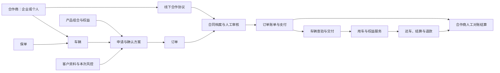

# 宁达 MVP 七模块与三端设计基线

日期：2026-10-27；修订：2026-10-28（Asia/Shanghai）  
版本：2.2（七模块总基线，合并合作商运营与只读入口修订）  
状态：v2.1七模块服务已部署；本次v2.2调整是用户确认的目标，尚未完成代码改造或上线。现网版本以[生产发布记录](../../evidence/ninda-seven-module-release.md)为准。  
执行文档：[七模块开发计划](../plans/2026-10-27-ninda-seven-module-mvp.md) · [本次R1–R6开发计划](../plans/2026-10-28-partner-operations-readonly.md)。

> 合作商流程、查看账号及合作财务权限以[2026-10-28 v2.2专项基线](2026-10-28-partner-operations-readonly-design.md)为最新依据。取消小程序客户账户绑定前置，运营依据线下协议维护合作资料；合作商管理员通过服务号手机号验证后只读查询。运营统一办理核算、线下付款登记和复核，保留经办/复核分权。此调整不代表现网门禁已经解除。

## 1. 本轮决定与适用顺序

用户指定七个业务模块：车辆管理、客户管理、合作商管理、保单管理、产品管理、订单管理、合同管理。合作商包括车主企业和个人；产品包括产品组合与权益；订单贯穿下单、风控、签署、支付、交车、还车。用户已确认分润首版采用“约定规则＋人工对账结算”。

2026-10-27 首批业务参数补充：两辆2024款ET5T月租4899元，沪BAU5799的2022款ET5月租3999元；三车均含电池租金，日常充换电客户自付，最低12个月、每月1500公里、超里程1.50元/公里。平台按月租收取20%服务费，具体计提、退款及结算条款仍由合作附件明确，不默认自动分账或合作商净应付。此为首批资料配置，不是全平台所有车型的固定定价；来源及实际草稿状态见[产品录入记录](../../evidence/ninda-product-intake-20261027.md)。

本基线在 [v2.0 线下签约设计](2026-10-26-ninda-offline-contract-mvp-design.md) 上扩展：替代其“仅企业车主”、旧后台导航、无结构化产品组合及无合作商结算的范围约定；保留线下签署、人工上传复核、档案版本、付款与交还车门禁、异常收车、人员管理、历史电子签隔离等全部不冲突细则。客户仍以个人承租人为首版范围。真实出租方可为企业或个人，宁达是平台服务方。

新订单不调用法大大签署，不依赖平台电子章/API。纸质合同由约定各方线下签署；线上保存审核通过的材料。界面“已归档”表示平台材料审核结果，不将其写成电子签成功。

小程序普通账户入口不展示或自动加载法大大新办理流程；公开能力由服务端新单模式和新增电子签总开关共同确定。用户可主动查看本人历史资料及归档文件，历史记录不改成线下状态；关闭新办理时，旧深链、供应商 URL 缓存和应用恢复不能重新启动电子签。配置失败只影响该办理能力，不阻断正常登录、协议和账单。客户身份及驾驶资格核验仍按客户管理规则办理。

采用现有模块化单体，为七个模块确定唯一的数据责任；各页面可以聚合其他模块信息，但不得复制一套可编辑的合同、保单、资金或权益状态。工作台、通知、文件、人员权限和系统设置是公共能力，不增加为第八个业务模块。

## 2. 全局约束

平台主体固定为上海宁达信息科技有限公司；服务器、微信支付商户及证书、短信签名、服务号和小程序沿用宁达匹配环境，不使用旧主体配置补缺。密钥仅留在服务端安全配置。

三端保持原黄黑主色：黄色 `#f9be00`、深色 `#231815`、底色 `#f6f4ee`。极简布局、熟悉导航、清晰主要操作与连贯订单进度，保留成功/错误语义色。

- 仅在本项目写入。旧仓库和旧数据库作为只读来源；禁止连接旧业务库做开发测试。
- 金额整数分；客户归属、后台 RBAC、版本冲突、事务幂等、支付回调校验不可省略。历史签署回调仍须验签和绑定原任务。
- 小程序原样副本不改写；真实版保持页面视觉，生产不回退 Mock。
- 法大大历史结构复用来源提交 `453da778dcfefd3727813179382490903644ef26`；本版不新增电子签执行，不读取落后的旧工作树替代历史来源。
- 密钥禁止输出/入 Git/入前端。真实支付、退款及历史签署处理需明确操作范围；本轮不执行。
- 并行人员只写分配目录；根安装、锁文件、schema、迁移、鉴权与应用注册由主控统一处理。不单独提交别人文件、不推送、不部署旧系统。
- 重要业务行为先测试，再实现和核验。采用现有 NestJS、Prisma/PostgreSQL、React/Vite、原生小程序，不引入新中间件。
- Node.js 为 `>=22 <25`，包管理器为 `pnpm@11.7.0`；依赖保持项目已锁定版本。
- 时间存储 ISO8601，业务日期与展示使用 Asia/Shanghai；分转元仅用于展示。
- 测试库仅本项目本地 loopback:55432/chundian_test；同一时刻一个 API 测试进程，不输出连接串。

## 3. 七模块职责与二级菜单

| 一级模块 | 二级菜单 | 本模块维护的事实 | 关联信息，只读聚合或跳转 |
| --- | --- | --- | --- |
| 车辆管理 | 车辆档案、车况与整备、上架与占用、查验历史 | 一车一档、权属关系、车况、位置、可交付条件 | 合作商、保单、适用产品、订单、交还车记录 |
| 客户管理 | 客户档案、资料核验、风控审核、授权与历史 | 客户资料、驾驶资格、客户授权、指定申请的审核记录 | 申请/订单、合同、支付与服务摘要 |
| 合作商管理 | 企业/个人档案、准入审核、合作范围、分润规则、对账结算 | 合作商身份与准入、车辆合作关系、规则版本、结算单 | 合作合同、名下车辆、订单收款事实 |
| 保单管理 | 保单档案、保障明细、续保待办、变更记录 | 车辆保单、险种/保障、有效期、审核与变更证据 | 车辆、受影响订单、事故服务工单 |
| 产品管理 | 产品组合、版本与上下架、适用车辆 | 可售组合、价格/租期/里程、随产品提供的服务规则、发布版本 | 被引用申请、订单权益授予和履约历史 |
| 订单管理 | 申请与订单、合同进度、账单与支付、押金与退款、交还车、用车服务 | 流程推进、确认方案、占车、应收/实收、交接、还车结算 | 客户风控结论、合作商、产品快照、保单、合同、合作商结算关联 |
| 合同管理 | 模板版本、合作协议、租赁合同、交还车单、补充/终止文件、待审核与档案 | 文件原件/扫描件、版本、签署方、人工审核、有效档案及反馈 | 来源合作商、订单、车辆、交接任务及阻断原因 |

资金操作集中在订单管理的“账单与支付”“押金与退款”；合作商管理维护对合作商的应付与结算记录。两者通过订单和真实收退款流水关联，不能互相修改对方的金额事实。

2026-10-29产品入口调整：取消“权益目录”独立二级菜单，既有产品关联及历史数据保留，历史直链称“产品服务配置”。随订阅产品提供的服务与单独付费加购是两类业务。里程包已有购买、支付与发放逻辑，当前独立商品管理及正式购买说明未形成可售交付；OFFLINE换车权益购买继续关闭。本次入口调整不开放新增销售，详见 `docs/evidence/ninda-final-plan-defaults-20261029.md`。

## 4. 各模块首版边界

### 4.1 车辆管理

一车一档，包含 VIN、车牌、品牌车型、年款、城市/停放位置、里程、电池健康、照片、车况披露、权属材料及当前合作商。VIN 为正式启用车辆的唯一标识；草稿允许缺失，上架前必须补齐并检查重复。

区分资产/整备状态与可售性：车况正常不表示可售；可售性还取决于合作有效、产品有效、无占用/占车和无整备冻结。保单有效性在详情及待办中可见，交车前必须通过保障门禁。占用状态由订单事务产生，不能用车辆表单手动解除。

2026-10-28 入口一致性补充：运营上架不等于客户可申请。目录、详情和首页推荐按同一合作资格判断；申请提交事务内再次校验。申请暂不收集实际起租日，因此按北京时间当前日期及所选产品租期预检合作覆盖，实际方案仍按确定的完整租期复核。可申请车辆的最低价来自可申请方案；全部方案暂不可申请时保留已发布报价并明确状态，不更改运营上架记录。

车辆与合作商关系保留生效、终止和证据。首版一辆车同一时点只有一个实际出租方；有未结束订单、占车或未处理交接时禁止更换出租方。历史订单始终读取原出租方快照。换车、主体转让不提供绕过原合同/金额变更流程的快捷编辑。

### 4.2 客户管理与风控

客户档案管理联系方式、身份及驾驶资格核验、到期时间、材料和服务记录。现有实名接口作为可复用核验能力；不因取消电子签而取消身份核验。线下补录须标明人工核验及证据，不能冒充渠道实名成功。

“风控审核”在客户管理集中处理，订单页直达本次申请的审核任务。新增轻量 `ApplicationRiskReview`，记录申请、客户资料版本、独立授权/信用核验版本、身份与驾驶资格检查、结论、原因、审核人和时间。结论为待审核、通过、拒绝、需补充；通过只对该申请的当前方案和输入版本有效。资料、信用核验、车辆或方案变化后按变更影响重新审核，不能复用客户过去某单的通过结论。

沿用 `CreditConsent/CreditVerification` 及其押金计算规则；本轮不增加自动征信引擎或新的评分阈值，不收精确信用分或信用截图。审核原因采用结构化原因码和补件说明，不扩大原信用核验可收集的信息。审核拒绝必须可说明原因、留下记录；客户看到需补充材料和处理结果，不暴露内部核验明细。客服只看处理状态，财务、车主和 FIELD 无风控明细权限。审核有效性实时受原信用授权/核验、资料版本和证件有效期约束，本版不另设新的信用评分或固定风控有效天数。

### 4.3 合作商管理：企业、个人及分润

产品统一称“合作商”，首版角色是车辆所有人/有合法出租权限的主体，不扩成渠道商或保险代理。底层复用 `VehicleOwner.id` 作为合作商标识，新增 `subjectType=ENTERPRISE|INDIVIDUAL`。企业：企业名称、信用代码、营业执照、线下协议签署代表及必要授权依据；个人：姓名、真实本人材料、车辆权属。上述均由运营登记为业务资料，不要求小程序客户账户或在线身份绑定。个人不填写企业信用代码、不称为法人；证件原文受保护，列表脱敏。

v2.2目标流程：运营建档 → 录入线下协议及附件、关联车辆、录入分润约定 → 提交合作资料 → 另一位获授权运营复核 → 满足业务条件后承接新订单。允许先保存待补草稿，已签协议直接归档真实原件；取消独立的账户经办关系提交/复核前置。主体、签署代表、出租权限、档案及规则仍保留真实材料和领域审核版本。`admissionStatus` 和“当前可合作”分开：后者实时检查准入、合作协议、车辆范围及规则有效性。

查看账号是独立访问授权：运营登记合作商管理员手机号并按权限复核后开通；可从服务号登录，只读查看明确授权范围。未设置手机号、未登录或停用查看账号不影响已成立的合作业务；换号不使协议、权属或旧订单失效。当前 `PartnerIdentityBinding/PartnerVerification` 的Customer依赖在改造时拆分，历史记录保留，不自动迁移为已审批。

合作协议说明车辆管理/出租及代收等已实际约定的范围、期限、双方职责、分润和结算；逐单租赁合同仍按客户、实际出租方、宁达三方办理。合作协议不能替代逐单合同，也不产生电子代签权限。合作暂停阻断新报价/新订单和未交车放行，已履约订单进入运营处理，不自动解约或抹掉资金记录。

分润采用以下受控台账，不发起自动分账、提现或合作商付款：

| 对象 | 必填内容与规则 |
| --- | --- |
| `PartnerRevenueRule` / 版本 | 合作商、合作协议版本、适用车辆、有效期、方式（比例/固定月额/其他约定）、计提项目、扣除与退款规则、结算周期、费用承担说明、创建与复核人。比例用整数 bps，金额用分；未明确事项不得给出默认比例或擅自扣费 |
| 订单规则快照 | 方案确认前冻结规则版本和适用范围；改产品、改规则不能倒改旧单。实际分润条款写在合作文件，客户订单只持内部引用，不向客户暴露商业比例 |
| `PartnerSettlement` / 明细 | 选择合作商、账期与订单，系统提供可追溯收款/退款参考；获授经办权限的运营人工填写本期分润、费用/调整、应付金额、计算说明，附依据。系统校验整数、汇总及重复引用，不按规则自动核算应付 |
| 复核与付款记录 | 草稿 → 已提交 → 复核通过 → 已登记实付；提交后不可原位改明细。由另一位获授对应复核权限的运营办理，编制/提交/材料上传人不能自审，ADMIN也不能绕过。线下付款后登记日期、金额、脱敏收款信息和凭证，独立复核后才显示“已付” |

押金不是租金收益，不进入分润计提基数。系统保留退款、冲正、争议金额和已分配结算引用；同一订单/来源/账期已纳入的份额不得重复结算。退款发生在结算后，以后续负数调整关联原结算，不回写已付单；负数应付显示待抵扣/追回，不能登记负数付款。首版实付按整单一次登记，不支持部分付款。

规则及收款对象变更生成新版本，经独立复核生效；已提交结算冻结收款对象版本。待付时收款对象失效须退回复核重新生成，不得直接改账户后付款。分润规则与合同材料保留各自审核记录，后台同一办理路径聚合进度。合作商可查看自己的已核准规则、已复核结算及实付状态；疑问通过电话或线下联系运营，由运营记录处理。H5不提供反馈、修改、审批或付款等业务写入口，历史未解决反馈继续保留。

### 4.4 保单管理

新增独立 `InsurancePolicy`、不可变的 `InsurancePolicyVersion` 与车辆关联。字段包括保险机构、保单号、投保/被保主体、被保车辆、险种与保障项目、保障额度、免赔说明、保费（如记录）、起止时间、附件、续保/批改关系、录入及复核人。金额用分；保障条款文本保留，不能从文案推断理赔结果。

同一车可同时关联多个险种/保单；一张多车保单须逐车关联，交车检查当前车辆的覆盖。原始保单号按保险机构范围去重，续保为新保单记录，批改/退保为带生效时间的新版本，不覆盖旧证据。文件上传人不得自审，拒绝后修改草稿重提；有效性由已审版本、时间、批改/退保状态计算，不能手工勾选“永久有效”。有效区间按 `[startAt,endAt)` 判断；仅录入日期时，截止日期转为次日北京时间零点，原文件明确具体时刻的按该时刻录入。

采用平台业务配置的保障要求清单，不在本设计中虚构险种法律要求、保额或赔付规则。交车必须存在已复核保单覆盖交付时刻，并满足对应车型/产品要求；缺少要求配置也显示阻断原因。租期长于保单有效期时生成续保待办，无需一张年度保单覆盖整个租期。默认提前 30 天、7 天以及到期当天提醒运营；续保缺口影响新交车，在租车辆产生紧急待办，不自动取消订单/改变账单。

保障要求采用车型基础清单与产品附加清单的并集，记录险种代码、最低保障额（如适用）和需人工核对的除外/免赔条款。材料复核保存逐项结论及要求版本，交车检查当前要求版本的已核对覆盖；要求升级产生补核验待办，不能把旧文字自动判为满足新要求。客户的历史合同承诺仍取订单快照，实际当前保障另行展示。

客户看到本车保障摘要、有效期及报案指引；合作商看本主体车辆保单；完整附件按字段/文件权限开放。事故记录复用订单“用车服务”的事故工单，关联保单，不建设保险公司接口、自动报价/投保或理赔支付系统。

### 4.5 产品管理：组合与权益

首版一个产品组合包含一个车辆订阅方案，加若干明确权益：租期、月费、里程额度、超里程单价、能源说明、可适配车辆/车型、服务内容及限制。一个订单选择一个组合；不同租期/权益组合发布为不同版本或产品。暂不建设购物车、多套餐叠加、优惠券及自由组合计价。

新增 `Product`、`ProductVersion`、`BenefitDefinition`，复用 `SubscriptionPlan` 作为车辆与已发布产品版本的兼容关联。产品版本是标准条款唯一来源；旧套餐字段只生成兼容投影，不允许两边独立编辑。最终报价的合理调整继续通过既有方案审核/客户确认，并冻结差异、产品版本及权益快照。

本轮不改变既有正常订阅的定价政策：租期 12–120 个月、每月 1500 公里、超里程 150 分/公里，月费为正整数分。首版可配置范围内的租期、月费、能源/服务说明与权益组合；这些数值写入产品版本，发布校验保留上述限制，报价从已发布版本读取。后续扩大短租或里程定价范围须单独调整产品政策及测试，不能仅放开前端输入。受控一分钱验收仍限原有授权范围。

权益定义至少包含名称、服务说明、供应/履约方、适用条件、类型（说明型/次数型）、次数单位、总次数、有效范围。首版次数型按整单额度授予，不自动按月重置；需要按月额度的权益先作为明确的说明型服务承诺，经工单人工核对，不伪造可扣次数。现有权益文本迁移为说明型，不猜测次数或余额。

流程：草稿 → 发布 → 停用。发布前检查条款、车辆适配和权益齐全；发布版本不可变，修改创建新版本。停用影响新申请/报价和尚未建立订单的方案确认；历史订单保留已确认版本。受影响申请须重新出方案并由客户确认，不能自动替换商品。确认方案冻结权益，正式交车后授予订单权益（扩展现有 `Entitlement`），授予幂等。客户申请服务 → 运营受理并预占次数 → 服务完成扣次 → 取消释放；人工更正用冲正记录，不能改余额掩盖历史。并发预占不得超额，退车后未使用权益按已确认规则到期。

`Entitlement` 属于客户已经获得的订单权益，`BenefitDefinition/ProductVersion` 属于未来可售承诺。产品页面可看履约统计；具体服务派单、权益预占/使用由订单服务执行。既有里程及换车额度账本继续使用，不用新次数台账重复计算这些同义额度；首次范围只给新增服务类次数权益增加预占与核销。

### 4.6 订单管理：端到端主线

统一订单工作台同时聚合申请阶段与正式订单，保持现有 `Application` 与 `Order` 分工：客户提交意向先产生申请，风控/方案审核完成、客户确认且事务占车成功后建立正式订单；不为让列表好看提前生成可收款订单。

| 阶段 | 责任方与动作 | 放行条件 |
| --- | --- | --- |
| 提交申请 | 客户选择车辆与产品、提交资料及独立授权 | 当前产品可售、车辆可申请；不承诺此时已占车 |
| 风控与报价 | 运营生成候选方案，完成本次核验后发布最终方案 | 风险审核绑定当前候选版本、合作商/车辆/规则可用，金额及权益完整 |
| 客户确认 | 客户核对租金、押金、租期、权益等 | 当前方案版本；事务锁定唯一车、产品/合作商/规则快照 |
| 线下签约 | 运营打印、收集三方签章、上传；另一人审核 | 合同与本单当前版本一致、三方齐全、材料无未解决异议 |
| 首笔付款 | 客户按已发布账单主动微信支付 | 当前合同档案有效；回调验真并幂等记账 |
| 查验交车 | FIELD 采集车况；客户核对；纸质交接单归档；运营完成 | 资金达到交车条件、合作资格/保障有效、当前查验版本及交车单齐全 |
| 用车 | 客户支付后续账单、申请权益服务 | 账单与权益均来自本单有效条款，不读实时商品价格 |
| 还车查验 | FIELD 记实际收车及车况，客户核对/反馈，归档还车单 | 争议留痕；已收车但未确认不能伪造正常结案 |
| 结算关闭 | 运营核定里程/损伤等明细，财务收退款 | 账款、押金、退款及争议处理完成；车辆整备后才可重新上架 |

订单、合同、支付、交接各自保存状态。合同归档不代表到账；到账不代表交付；线上查验确认不代替纸质合同签字。v2 的 `AWAITING_CONTRACT_REVIEW → AWAITING_PAYMENT → HANDOVER → ACTIVE → SETTLING → COMPLETED` 及取消分支继续使用，不将七模块名称塞进订单状态。

异常取消、纸已签但扫描件未通过、实际收车暂停未来账单、退款分权、历史回调竞态，完整继承 v2 第 6–9 节。本次增加保单/合作资格门禁不回滚已发生的可信收款或物理收车事实；阻断新的履约动作并产生待办。

### 4.7 合同管理

统一管理线下合作协议、三方租赁合同、交/还车单、补充/终止文件及模板。合同模块是 v2 `DocumentArchive/ArchiveVersion/ArchiveFile/ArchiveFeedback` 的统一工作台，不新建第二套签署文件库；同一档案可从订单、合作商、车辆详情打开。

沿用草稿、待审核、退回、已归档、已失效及版本链。逐方核验身份/签章、日期、车辆、条款、附件、原件保管位置；运营收集与另一名获授权人员审核分离。FIELD 仅能上传本人任务的交还车材料。客户可查看本人副本并反馈；合作商仅只读查看，资料更正由运营办理。双方不通过该入口上传合同或点击电子签。

合作协议通常按合作期间及车辆范围复用；租赁合同按订单逐单签署；交/还车单绑定本次查验版本。首版不开放自助补充签约，现有必要变更仍按 v2 受控线下文件与既有交易规则处理。归档后文件不可覆盖；失效、纠错、重新归档均留下审核记录，合同旧版不能被新附件悄悄替换。

## 5. 三端信息架构与操作体验

| 端 | 一级导航 | 核心页面与任务 |
| --- | --- | --- |
| 客户小程序 | 首页 / 选车 / 用车 / 我的 | 选车查看产品组合；申请内补资料/授权；用车以订单为中心聚合付款、合同、保障摘要、查验、权益与服务；我的维护本人资料及历史 |
| 合作商 H5（车主端） | 合作概览 / 车辆 / 订单 / 分润结算 | 概览进入已发布合作资料及协议；只读展示明确授权主体的车辆、必要订单、规则和已复核结算，电话联系运营办理更正 |
| 平台后台 | 车辆 / 客户 / 合作商 / 保单 / 产品 / 订单 / 合同 | 工作台聚合待风控、待合同审核、待交还车、待续保、待结算；系统设置承载人员、权限、业务配置、审计 |
| FIELD（后台的移动工作区） | 我的任务 / 任务详情 | 服务号既有员工入口进入，只看派给自己的查验、交接、纸质单上传、异常收车任务 |

保留已配置的 FIELD 地址 `https://admin.evsub.ndacar.com/field.html`。合作商 H5 复用 `/owner/`，目标菜单为“合作商中心”，实施时核实实际菜单；企业、个人均为只读资料。后台沿用车辆详情式“处理概览／详细资料”双页签抽屉，合作资料与查看账号分别维护。

订单详情固定“概览 / 方案 / 合同 / 资金 / 交还车 / 用车服务 / 记录”。每个阶段只突出一个当前可执行主动作，并显示阻断原因与责任人；操作后自动刷新相关进度。客户无需理解内部审核表，运营无需在七模块之间反复手工找关联编号。

2026-10-28 用户指定以现有“车辆详情”为后台二级抽屉的视觉基准：统一标题栏、状态与当前操作区、页签、内容留白和独立滚动区。合作商、分润结算、保单与保障要求、产品权益及合同详情复用该布局；顶层操作集中呈现，所有编辑和审核保留对应版本上下文。保单当前版本的编辑、提交及独立复核可从顶部直接办理，表单明确显示版本；历史版本的操作保留在相应资料分区。新建保单使用抽屉表单，长表单底部操作栏与车辆表单一致。长资料以分区和分隔线组织，避免连续嵌套大卡片及内容贴边。切换页签不得丢弃未提交输入或重置命令幂等键，切换记录不得沿用前一记录的表单；权限和业务流程不因布局调整而变化。

客户与合作商、员工身份可以属于同一自然人，但认证会话和授权关系独立。客户登录或手机号匹配不直接获得合作商/员工权限。H5按独立查看手机号授权，不要求Customer；换号、停用或撤销范围后旧会话及旧短信挑战立即失去对应权限，客户租赁关系不受影响。所有合作商业务写接口由服务端拒绝，仅短信、登录、退出等明确认证动作例外；GET逐对象核验权限且不触发业务状态变化。

## 6. 员工岗位、动作权限与数据权限

v2.2将合作相关工作统一交运营，通过逐项经办/复核能力授权。下列角色继续兼容现有员工，不以角色名直接授予全部合作财务权限；不属于本次合作商改造的客户收退款权限维持专用门禁。

| 角色 | 主要写操作 | 限制 |
| --- | --- | --- |
| ADMIN | 人员与配置、必要业务复核、异常协调 | 不绕过材料自审、结算/退款分权、版本和审计 |
| OPERATIONS | 车辆、客户及风控、保单、产品、订单、合同、权益；按能力办理合作资料、查看账号、分润核算、结算及实际线下付款登记 | 经办与复核分权且由不同实际人员办理；未经授权不能读完整财务材料或办理资金动作，不能手工伪造客户已到账 |
| FINANCE（兼容） | 原有客户收退款专用权限和历史操作保留；合作权限由ADMIN明确映射 | 不作为合作办理的必备独立岗位，不自动改成运营或提权；每次复核仍排除本人编制/上传材料 |
| SUPPORT | 必要客户/订单处理状态、服务受理与转派 | 无风控明细、完整证件、分润及财务审批；权益最终扣次由 OPERATIONS 执行 |
| FIELD | 本人交还车任务、查验材料、实际收车记录 | 无七模块后台列表，无客户证件/风控、分润、合同审核或资金权限 |

客户只看本人对象，合作商只看当前明确授权范围内的车辆、必要订单和已复核结算。合作商订单页不暴露客户证件、信用档位、内部风控和完整支付流水；逐单资料共享仍要求客户有效同意。历史已终止合作保留经批准的本主体合同/结算历史只读范围，不继续暴露新订单。完整收款账户仅获授对应财务能力的内部人员可见，其他人员及外部账号脱敏。

为核对分润，获授对应合作结算能力的运营可读取已归档合作协议及本次结算依据文件；不因此获得客户证件、风控或交还车原始档案权限。合同材料复核与分润/付款复核分别授权，旧文件端点同样按能力、档案种类及对象校验。普通运营不能因看见合作菜单即读取全部财务底稿。

权限同时落在列表、详情、导出、文件下载、旧通用资源API和新动作端点；菜单隐藏不能代替服务端校验。保留员工岗位字段，增补合作业务动作能力；人员创建、停用/重置凭据、会话撤销、最后管理员保护及任务重派继续按v2/v1.1定义实施。

## 7. 实体与接口实施边界

以下汇总七模块的领域职责；v2.1已实现的项目不重复开发，v2.2新增的合作解耦、查看账号及动作权限仍待实施。当前实现与目标接口分别查阅[API契约](../../api-contract.md)、[七模块增量](../../api-seven-module-mvp.md)和[H5版本边界](../../api-owner-h5.md)，本文件不声称目标端点已上线。

| 领域 | 复用 | 新增/扩展 |
| --- | --- | --- |
| 合作商 | VehicleOwner、OwnerVehicle、既有 H5 地址及历史身份记录 | 合作业务核验与Customer解耦；独立PartnerPortalAccess/Session/短信挑战；版本化合作范围与收款对象、PartnerRevenueRuleVersion、PartnerSettlement/Line/PaymentRecord |
| 客户 | Customer、CreditConsent、CreditVerification、Application | CustomerQualificationVersion、ApplicationRiskReview，绑定本次资料/方案和授权版本 |
| 保单 | File、Vehicle、ServiceRequest | InsurancePolicy/Version/Vehicle、CoverageRequirementVersion、续保提醒去重键 |
| 产品权益 | SubscriptionPlan、FinalPlan、Entitlement、ServiceRequest | Product/Version、BenefitDefinition/Version、组合项、EntitlementReservation/Ledger、订单产品与权益快照 |
| 订单合同 | Application、Order、Bill、Payment、Deposit、Refund、Handover | 复用 v2 模式/档案/实际收车设计；增加产品、合作商规则、保险查验依据的版本引用 |

所有编辑带 revision，业务命令带幂等键；事务内校验资源归属及当前版本。提交/审核/发布类操作锁定资源或使用条件更新，审核失败不能留下半套关联。新增版本采用不可变记录，不使用通用 PATCH 修改已发布/已审核字段。

v2.2目标接口分组（尚未实现）：

- `/admin/partners/:ownerId/cooperation-draft`及原提交/复核端点：关联主体、真实线下档案、车辆与规则版本，移除Customer身份绑定前置；原各领域的严格审核仍保留。
- `/admin/partners/:ownerId/portal-access`及独立提交/复核/停用端点：维护只读手机号候选和当前有效授权，不改业务主体版本。
- `/admin/users/:id/partner-capabilities`及既有合作规则、账户、结算和实付端点：配置并验证运营动作权限；每个经办/复核动作独立校验，不扩大其他客户资金权限。
- `/owner-h5/auth/*`、`/owner-h5/owners/:ownerId/...`：独立手机号认证及合作商只读安全投影；新反馈和其他业务写请求拒绝，客户Bearer与后台Cookie均不作为H5凭据。精确DTO及白名单见[API增量v2.2](../../api-seven-module-mvp.md)。

## 8. 现状、迁移与验收

2026-10-27 只读核查发现：当前 `VehicleOwner.creditCode` 必填，`owner-h5/legal-representative.ts` 按企业法人授权；`SubscriptionPlan` 逐车存价与 `benefits:string[]`，`Entitlement` 仅标题/描述/状态；保险只在 `applications/commercial-terms.ts` 中体现为文字。未发现完整保单/分润模型。客户信用授权与核验、订单、支付、车辆交接、合同电子签等已有基础，但不能把已存在的电子签实现当成本版线下流程已完成。

迁移按兼容扩展执行：既有车主标为 ENTERPRISE，不自动补“个人准入通过”；历史商品和权益保留原快照，旧权益文本标为说明型；旧保单文字保留历史合同语义，不伪造结构化保单/审核。首次切换前运营补齐可售车辆的正式产品、准入、规则和保单资料，未齐的禁止对应新业务动作。新订单 OFFLINE，旧 ESIGN 历史只读/受控核验。旧通用写接口封堵后，兼容读取仍按原订单模式处理。

验收必须覆盖：企业及个人各一条合成全流程；一个自然人跨客户/合作商身份越权拒绝；风控过期/版本变化不能报价放行；产品停用/改版不改旧单权益；同车并发占用失败；保单过期或退保阻断新交车但不删除在租事实；三方材料缺失不能付款；两名员工独立复核；真实收款事实和合同失效竞态；实际收车未确认的账单处理；分润结算重复引用、退款后调整与自审拒绝；权益并发超额拒绝。合成测试不发起真实支付或电子签。

本版完成标准是七个模块可维护各自事实，三端围绕角色完成同一订单闭环；不是把现有资源列表改成七个标题即完成。详细施工顺序与旧 O01–O14 任务的对应关系见开发计划。

## 2026-10-27 实施对齐

以下为v2.1历史实现状态，不是本次v2.2完成证明：七模块源码和三端已按当时基线接入，保留黄黑视觉与既有入口。实现接口见 [API 增量](../../api-seven-module-mvp.md)，原运行边界见 [操作手册](../../operations/ninda-seven-module.md)，测试与上线边界见 [开发验收记录](../../evidence/ninda-seven-module-acceptance.md)。工作台按岗位汇总真实待办，订单时间线区分实际收车与正式还车；异常到账由独立财务核对，未核对款不放行履约。v2.2合作商解耦、只读授权及运营权限调整须按R1–R6另外实施验收。
